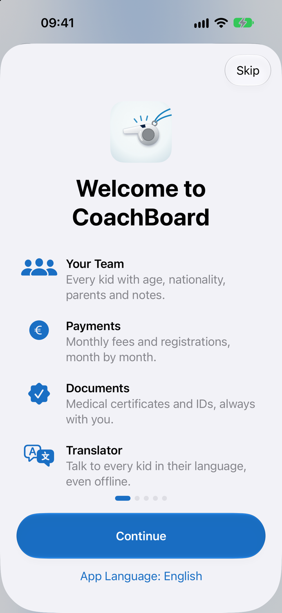
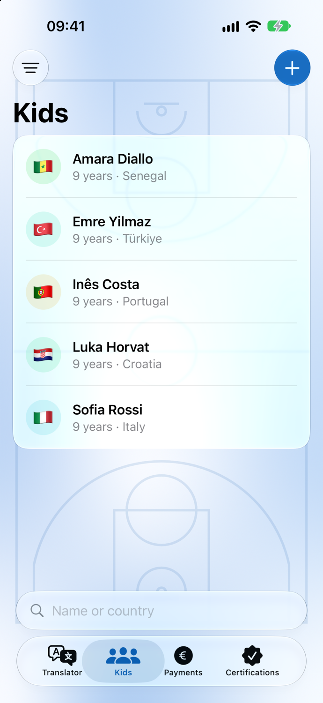
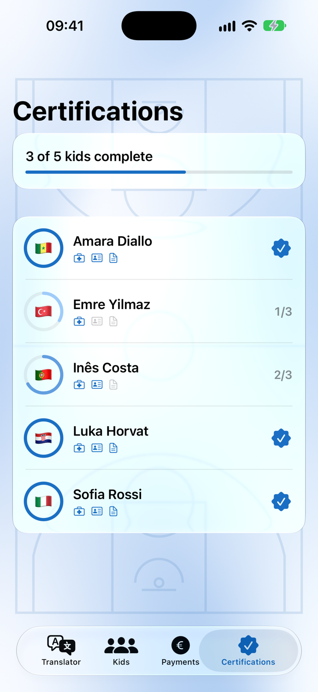
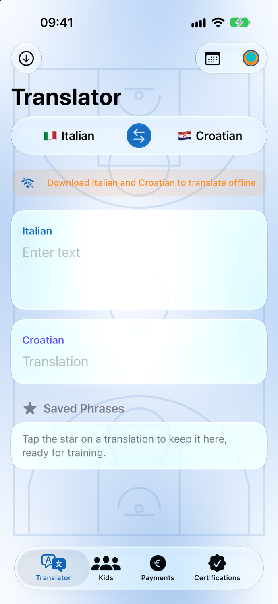
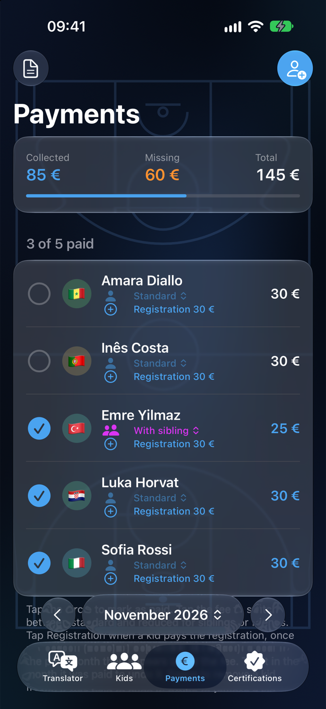
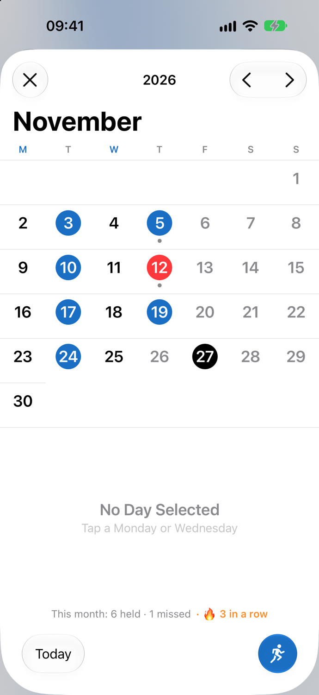
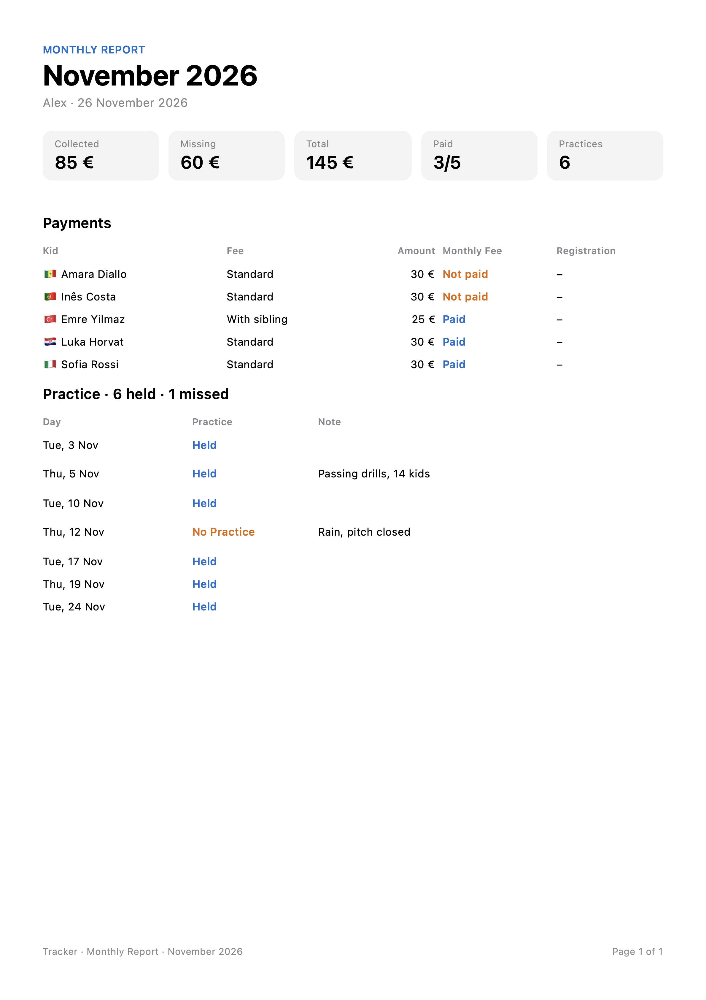

# CoachBoard: A Team App for Kids' Coaches

**Your whole team in one place.** CoachBoard is an iPhone app for coaching a kids' team: who's on the team, who has paid this month, which documents are still missing, whose birthday is coming up, when the next practice is, and an offline translator for talking with kids who speak another language.

<p align="center">
  
  
  
  
  
</p>
<p align="center">
  
  
  
  
</p>

<sub>The kids in the screenshots are made up.</sub>

- **Platforms:** iPhone, iOS 26.0+, with Home Screen and Lock Screen widgets
- **Language:** Swift with SwiftUI, SwiftData and CloudKit. One dependency: Google ML Kit for offline translation, through CocoaPods.
- **App languages:** English, Italian, Croatian, Spanish, French, German and Portuguese
- **Privacy:** the data lives on the iPhone and in the coach's own private iCloud. Translation runs on the device.
- **Status:** on TestFlight (see [Status](#status-what-is-verified-and-what-isnt)).

---

## Contents

1. [What it does](#what-it-does)
2. [How it works](#how-it-works)
3. [Fees and seasons](#fees-and-seasons)
4. [Design](#design)
5. [Privacy](#privacy)
6. [Technologies](#technologies)
7. [Project structure](#project-structure)
8. [Build and run](#build-and-run)
9. [Status: what is verified and what isn't](#status-what-is-verified-and-what-isnt)

---

## What it does

Four tabs:

1. **Translator.** Type a sentence and translate it between any of the 59 languages ML Kit knows, offline once both languages are downloaded. **Read Aloud** speaks it in the right voice, and the star keeps a translation in **Saved Phrases** for the next practice.
2. **Kids.** Every kid with their flag, age, parents and notes. Sort by name, age, nationality or newest, filter by nationality, and search by name or country from the field at the bottom. A cake shows next to anyone with a birthday this month.
3. **Payments.** One list per month: tick who paid. Still to pay stays on top, paid goes to the bottom, each group A–Z. Each kid pays the standard fee or a reduced one (with a sibling or a friend). The card at the top shows what's collected, what's missing and the total.
4. **Certifications.** Each kid needs a medical certificate, an ID copy and a registration form. A ring shows how many are in, and the top card says how many kids are complete.

Also:

- **Reports.** A PDF of the month (payments and practice log) or of the whole season (every kid, month by month), from the Report menu in Payments. The report can be in English or Italian, whatever language the app is in. Quick Look opens it with the share button, for Mail, WhatsApp, Files or printing.
- **Widgets.** Next Birthdays, Payments (who paid this month, and who is still to pay) and Next Practice (with the week's training days), in small and medium sizes on the Home Screen and on the Lock Screen.
- **iCloud sync.** Kids, payments, files and the practice log are saved in the coach's iCloud, so they come back after deleting the app and stay in sync across devices.
- **Face ID lock.** Optional: CoachBoard asks for Face ID or the passcode every time it opens and stays hidden in the app switcher.
- **Practice calendar.** Pick the training days, mark each one held or not held, and write a note on any day.
- **Documents.** Scan a paper with the camera, or import a file. Open any file to preview it.
- **Birthdays.** Reminders a week before and two days before, then on the day. Opening the app on someone's birthday shoots confetti and shows "Happy birthday".
- **First launch.** A short whistle animation, then a welcome tour: the coach's name, the sport, training days, translator languages and birthday reminders. It can be opened again from the profile.
- **Fees.** The amounts for the standard fee, the sibling and friend fees and the registration are set in My Profile › Fees. New amounts count from the current month on; earlier months keep the amounts they had.
- **My profile.** The coach's name, phone, email, picture, ID document and other files, and the sport (basketball, football, volleyball, handball, tennis or none), which picks the court drawn behind the app.

---

## How it works

### Data (`Tracker/Models/Models.swift`)

SwiftData models: `Kid`, `Coach`, `StoredFile`, `PaymentEntry` and `PracticeDay`. A kid owns their files and payment entries, and deleting a kid deletes those too. Files are stored as external data, so big scans don't slow the database down. New fields are only ever added with defaults, so updates never lose saved data.

### iCloud (`Tracker/TrackerApp.swift`)

The same store is mirrored to the coach's private CloudKit database. CloudKit needs every relationship to be optional, so `files` and `payments` are optional arrays. If iCloud can't be used (no account, or a build without the entitlement), the app falls back to a store on the iPhone only. `Shared/CloudKitSchema.swift` is a debug-only helper that creates the record types in the development database, so the schema can be deployed to production.

### Payments and reports (`Tracker/Payments/`)

A month is a list of `PaymentEntry` rows, one per kid on the team that month. An empty month offers the latest earlier list as a template, keeping each kid's last fee. Each row keeps the fee type together with the amounts it had when it was set (`standard|30|30`), so changing the amounts later doesn't rewrite past months, and no new database field was needed. `Report.swift` builds the PDFs from SwiftUI views with `ImageRenderer`, one A4 page at a time, and splits long tables across pages, repeating the header row. Strings and dates are looked up in the report's language, not the app's.

### Widgets (`TrackerWidget/`, `Tracker/Shared/WidgetData.swift`)

The app writes a small JSON snapshot (birthdays, this month's payments, training days) to a shared App Group container whenever the data changes, and asks WidgetKit to reload. The widget extension only reads that file. `Snapshot.swift` is the same file in both targets.

### Translation (`Tracker/Translator/TranslationEngine.swift`)

ML Kit downloads one model per language once, then translates without a connection. Apple's Translation framework has no Croatian, which is why ML Kit is used. The engine is wrapped in `#if canImport(MLKitTranslate)`, so the rest of the app still builds without the pod.

### Birthday reminders (`Tracker/Shared/BirthdayReminders.swift`)

Reminders go out a week and two days before (at 10:00), then on the day at 00:00, 09:00 and 13:00. iOS keeps at most 64 pending notifications per app, so only the soonest 60 are scheduled, and the list is rebuilt whenever a name or birthday changes.

### Launch and lock (`Tracker/Shared/LaunchSplash.swift`, `AppLock.swift`)

The whistle on the launch screen is drawn in code (`WhistleMark.swift`) from the same shapes as the app icon, so it can jump out of the icon, buzz and drop back in. With the Face ID lock on, the lock screen fades in over the animation when it ends, so the team is never shown before unlocking.

---

## Fees and seasons

The amounts below are the defaults. Each one can be changed in My Profile › Fees.

| | Default |
| --- | --- |
| Monthly fee | 30 € |
| Monthly fee with a sibling | 25 € |
| Monthly fee with a friend | 25 € |
| Registration, once per season | 30 € |

A season runs from September to August. A registration paid in any month of the season counts for the whole season.

---

## Design

- Standard iOS look with Liquid Glass tab and toolbar buttons, in light and dark mode. The app icon has light, dark and tinted versions.
- A slowly moving blue background with the coach's court drawn in faint lines, at its real proportions. The cards on top are clear Liquid Glass, so the court shows through, slightly bent and softened.
- Status in words and icons, not colour alone: "3 of 5 paid", "2/3", a check or a ring.
- Haptics on uploads, on the launch whistle and on the birthday celebration. With Reduce Motion on, the launch shows the still icon and the celebration shows only the pill, without confetti.

---

## Privacy

- Kids, payments, files and notes are stored on the iPhone with SwiftData and, when the coach is signed in to iCloud, in their own private iCloud database. Nobody else can read it, including the developer.
- Translation models run on the device. The only other network use is downloading a language model when you ask for it.
- No account, no ads, no analytics.

---

## Technologies

| Area | Frameworks and techniques |
| --- | --- |
| Language | Swift, main-actor default isolation with Approachable Concurrency |
| UI | SwiftUI, `Tab` API, `MeshGradient` background, `Canvas` for the courts and the launch animation, Liquid Glass (`UIGlassEffect`) cards, custom confetti |
| Data | SwiftData with CloudKit sync, cascade relationships and external storage |
| Widgets | WidgetKit, App Groups |
| Security | LocalAuthentication (Face ID, Touch ID or passcode) |
| Reports | `ImageRenderer` into a PDF context, QuickLook |
| Documents | VisionKit document camera, PDFKit, QuickLook, file importer |
| Translation | Google ML Kit Translate (CocoaPods), AVSpeechSynthesizer |
| Localization | String Catalogs, seven languages |
| Reminders | UserNotifications |
| Checks | `#if DEBUG` self-checks for months, seasons and fees, run at launch |

---

## Project structure

The app started out as Tracker, and the code still uses that name: the Xcode project, the targets, the folders and the bundle identifiers.

```
CoachBoard/
├── Tracker/
│   ├── TrackerApp.swift      Tabs, iCloud store, launch animation, birthday celebration
│   ├── Models/               SwiftData models, fees, months and seasons
│   ├── Onboarding/           Welcome tour
│   ├── Translator/           Translator, offline languages, practice calendar, coach profile
│   ├── Kids/                 Team list and kid profiles
│   ├── Payments/             Monthly lists, month picker, fee settings, PDF reports
│   ├── Certifications/       Documents per kid
│   ├── Shared/               Documents, countries, birthdays, confetti, Face ID lock,
│   │                         widget data, launch whistle, courts, glass cards
│   ├── Localizable.xcstrings
│   └── Assets.xcassets
├── TrackerWidget/            Birthdays, Payments and Next Practice widgets
├── Tracker.xcodeproj
├── Tracker.xcworkspace       Open this one (CocoaPods)
├── Podfile
└── .github/                  Banner and README screenshots
```

---

## Build and run

Requirements: Xcode 27 and CocoaPods on macOS.

```bash
pod install
```

```bash
open Tracker.xcworkspace
```

Pick the **Tracker** scheme and run on an iPhone. Signing uses your own team. The iCloud container (`iCloud.com.alessandrosignorile.Tracker`) and the App Group (`group.com.alessandrosignorile.Tracker`) belong to my team, so change them in the entitlements files and in `TrackerApp.swift` / `Snapshot.swift` to ones of yours.

---

## Status: what is verified and what isn't

**Verified**

- The full app builds for iPhone with no warnings and runs on a real iPhone through TestFlight.
- The app minus the ML Kit pod runs in the iOS simulator. The screenshots come from that build, filled with made-up kids, with iCloud turned off.
- The launch animation, the Face ID hand-off, the widgets, the glass cards, the fee settings and the reports in both languages were checked in that simulator build.

**Not verified yet**

- iCloud sync between two devices.
- There is no unit test target. The month and fee maths is covered only by the debug self-checks.

---

© 2026 Alessandro Signorile. All rights reserved.
