# CoachBoard: A Team App for Kids' Coaches

**Your whole team in one place.** CoachBoard is an iPhone and Mac app for coaching a kids' team: who's on the team, who has paid this month, which documents are still missing, whose birthday is coming up, when the next practice is, and a translator for talking with kids who speak another language.

### On the Mac

<p align="center">
  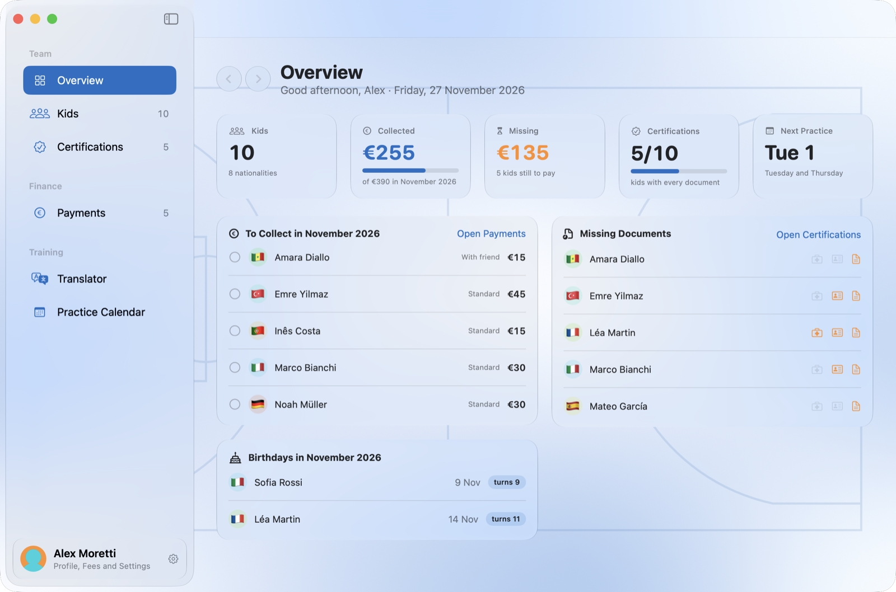
  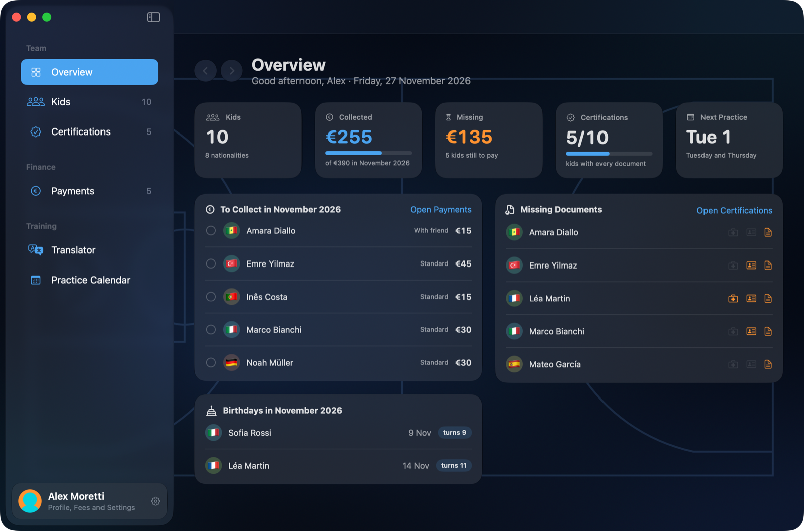
</p>
<p align="center">
  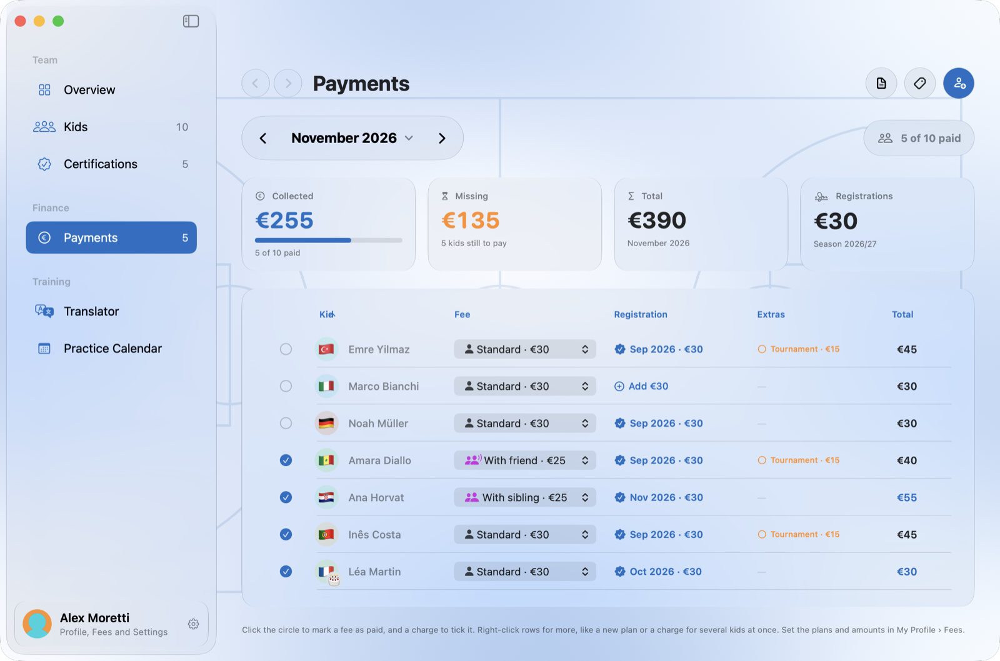
  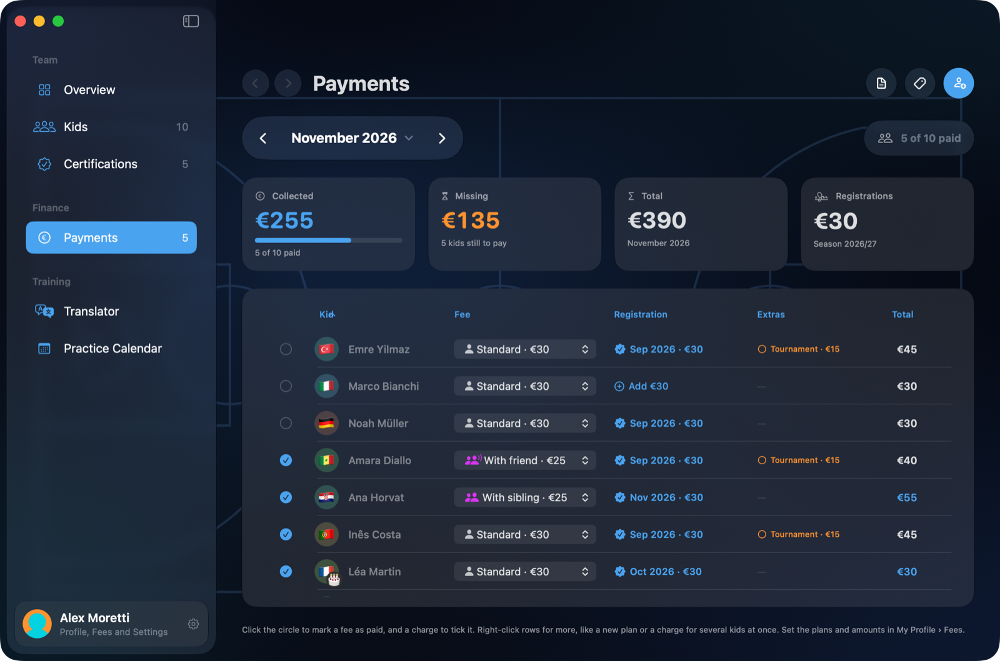
</p>
<p align="center">
  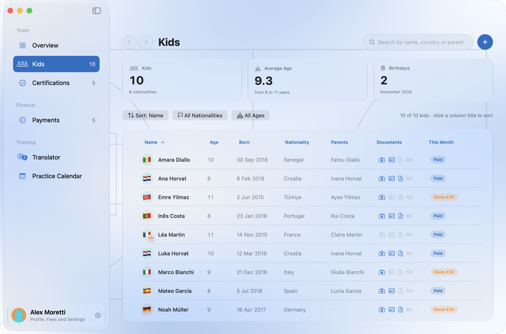
  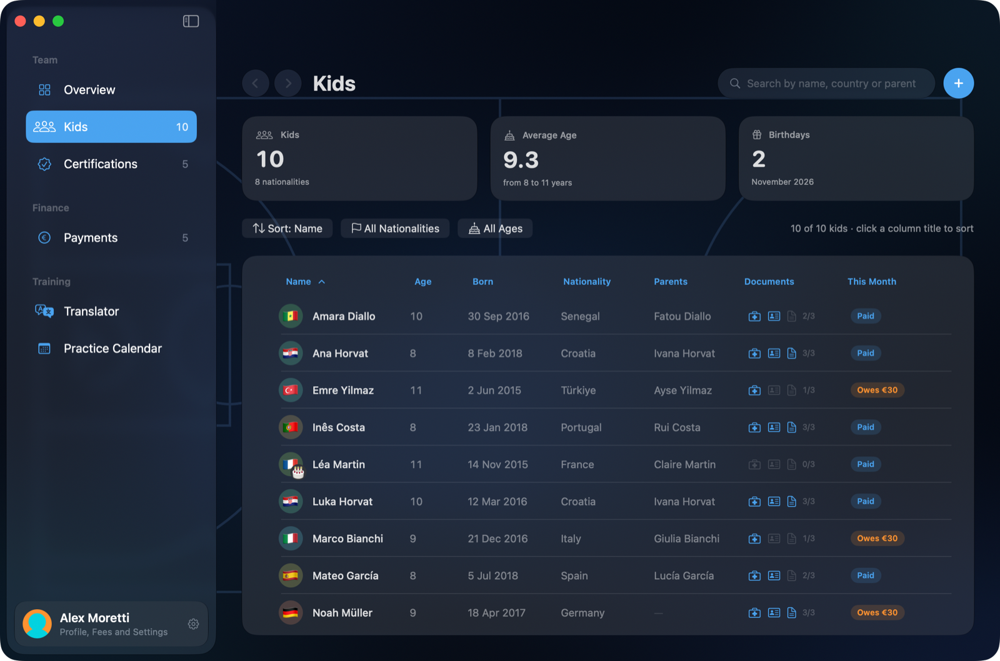
</p>
<p align="center">
  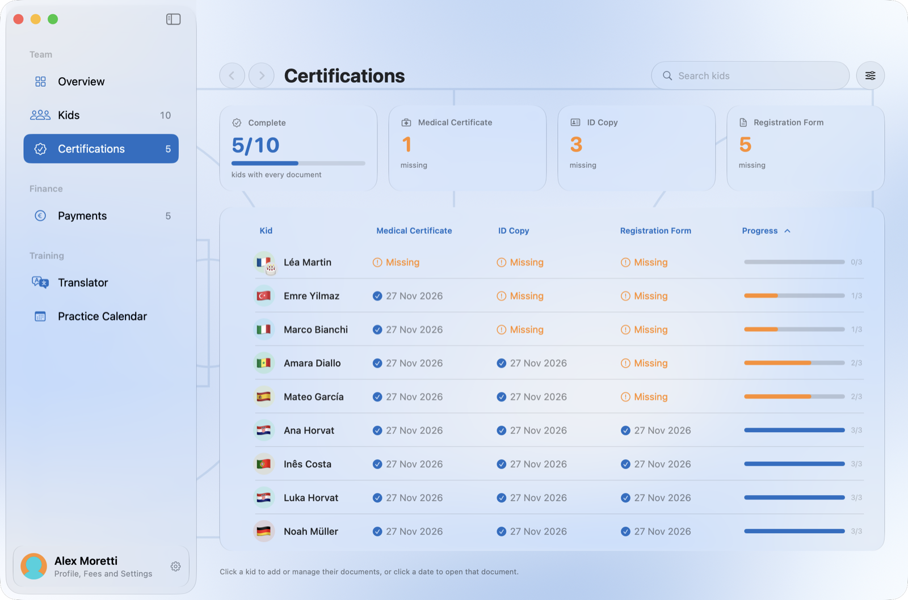
  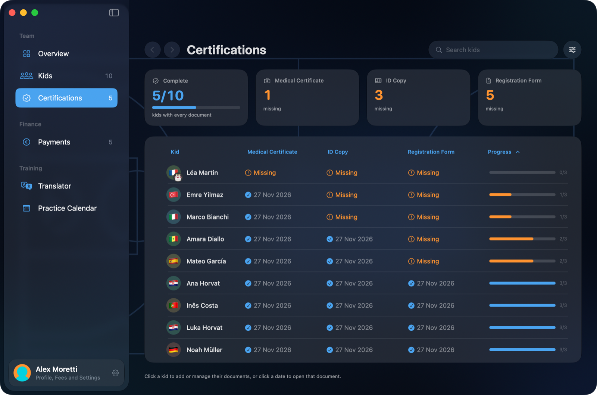
</p>

### On the iPhone

<p align="center">
  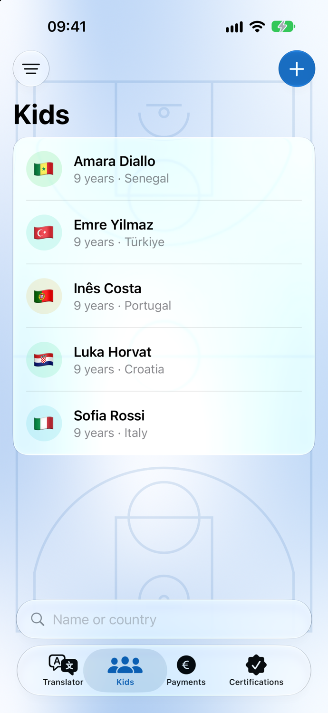
  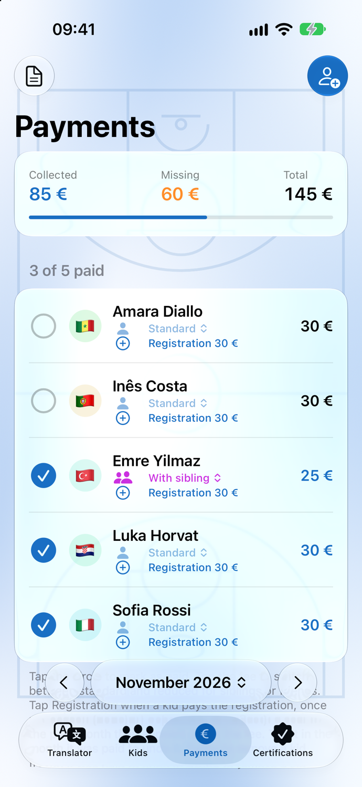
  
  
  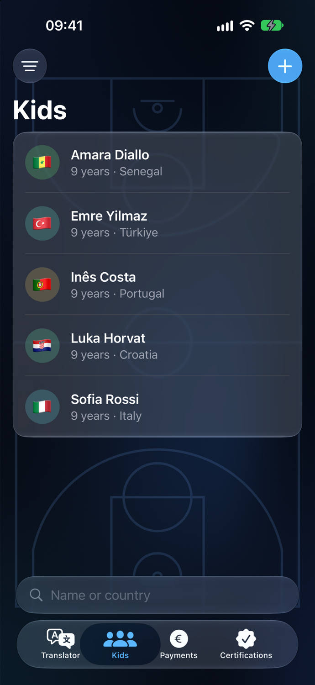
</p>
<p align="center">
  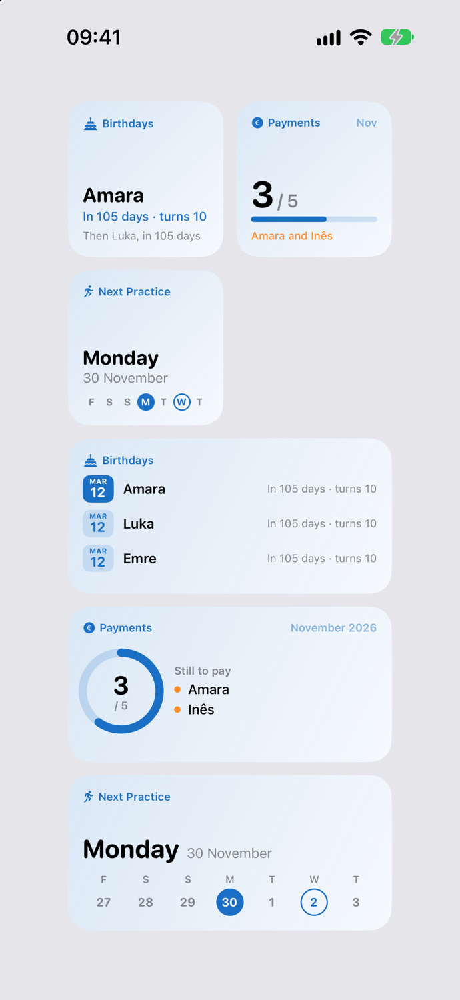
  
</p>

<sub>The kids and the coach in the screenshots are made up.</sub>

- **Platforms:** iPhone (iOS 26.0+, with Home Screen and Lock Screen widgets) and Mac (macOS 26+, Mac Catalyst). One app for both, with the same data through iCloud.
- **Language:** Swift with SwiftUI, SwiftData and CloudKit. One dependency: Google ML Kit for offline translation on the iPhone, through CocoaPods.
- **App languages:** English, Italian, Croatian, Spanish, French, German and Portuguese
- **Privacy:** the data lives on the coach's devices and in their own private iCloud. On the iPhone translation runs on the device (see [Privacy](#privacy) for the Mac).
- **Status:** on TestFlight (see [Status](#status-what-is-verified-and-what-isnt)).

---

## Contents

1. [What it does](#what-it-does)
2. [The Mac app](#the-mac-app)
3. [How it works](#how-it-works)
4. [Fees and seasons](#fees-and-seasons)
5. [Design](#design)
6. [Privacy](#privacy)
7. [Technologies](#technologies)
8. [Project structure](#project-structure)
9. [Build and run](#build-and-run)
10. [Status: what is verified and what isn't](#status-what-is-verified-and-what-isnt)

---

## What it does

Four tabs on the iPhone:

1. **Translator.** Type or say a sentence and translate it between any of the 59 languages ML Kit knows, offline once both languages are downloaded. The microphone turns speech into text in the source language. **Read Aloud** speaks the translation in the right voice, and the star keeps it in **Saved Phrases** for the next practice.
2. **Kids.** Every kid with their flag, age, parents and notes. Sort by name, age, nationality or newest, filter by nationality, and search by name or country from the field at the bottom. A cake shows next to anyone with a birthday this month.
3. **Payments.** One list per month: tick who paid. Still to pay stays on top, paid goes to the bottom, each group A–Z. Each kid is on a fee plan, can owe the season's registration, and can have extra charges like a kit or a tournament, each ticked on its own. The card at the top shows what's collected, what's missing and the total.
4. **Certifications.** The documents each kid has to hand in: by default a medical certificate, an ID copy and a registration form. Any of them can be switched off and new ones added with their own name. A ring shows how many are in, and the top card says how many kids are complete.

Also:

- **Reports.** A PDF of the month (payments, extra charges and practice log) or of the whole season (every kid, month by month), from the Report menu in Payments. The report can be in English or Italian, whatever language the app is in. Quick Look opens it with the share button, for Mail, WhatsApp, Files or printing.
- **Widgets.** Next Birthdays, Payments (who paid this month, and who is still to pay) and Next Practice (with the week's training days), in small and medium sizes on the Home Screen and on the Lock Screen.
- **iCloud sync.** Kids, payments, files and the practice log are saved in the coach's iCloud, so they come back after deleting the app and stay the same on the iPhone and the Mac. The club settings (fee plans, registration, season, currency, documents, training days, sport, report language) sync too.
- **Face ID lock.** Optional: CoachBoard asks for Face ID, Touch ID or the passcode every time it opens and stays hidden in the app switcher.
- **Practice calendar.** Pick the training days, mark each one held or not held, and write a note on any day.
- **Documents.** Scan a paper with the camera, or import a file. Open any file to preview it.
- **Birthdays.** Reminders a week before and two days before, then on the day. Opening the app on someone's birthday shoots confetti and shows "Happy birthday".
- **First launch.** A short whistle animation, then a welcome tour: the coach's name, the sport, training days, translator languages and birthday reminders. It can be opened again from the profile.
- **My profile.** The coach's name, phone, email, picture, ID document and other files, the fees, the documents to track, and the sport (basketball, football, volleyball, handball, tennis or none), which picks the court drawn behind the app.

---

## The Mac app

The same app, built with Mac Catalyst and laid out for a big window instead of stretched from the phone:

- **A floating glass sidebar** with Overview, Kids, Certifications, Payments, Translator and the practice calendar, and the coach's profile at the bottom. Drag its edge to make it wider or narrower; drag it far enough and it hides. The button at its top (or ⌃⌘S) shows and hides it, in a window and in full screen.
- **Overview.** This month at a glance: kids, money collected and missing, complete documents, the next practice, who still has to pay (tick them right there), missing documents and this month's birthdays.
- **Tables.** Kids, Payments and Certifications are sortable tables. One click opens a kid. Right-click a row for more, like changing the fee plan or adding a charge to several kids at once. Kids has sort, nationality and age filters in plain sight, and ⌘F searches.
- **Back and forward** arrows by each page title (⌘[ and ⌘]), like in Finder.
- **Sheets open as panels** over the window, closed with Esc or a click outside.
- **Translator.** Apple's own translator for the languages it has, and MyMemory online for the rest, Croatian included (ML Kit isn't available on the Mac).

---

## How it works

### Data (`Tracker/Models/Models.swift`)

SwiftData models: `Kid`, `Coach`, `StoredFile`, `PaymentEntry`, `ExtraCharge` and `PracticeDay`. A kid owns their files and payment entries, a payment entry owns its extra charges, and deleting one deletes what it owns. Files are stored as external data, so big scans don't slow the database down. New fields are only ever added with defaults, so updates never lose saved data.

### iCloud (`Tracker/TrackerApp.swift`, `Tracker/Shared/SettingsSync.swift`)

The same store is mirrored to the coach's private CloudKit database. CloudKit needs every relationship to be optional, so `files`, `payments` and `charges` are optional arrays. If iCloud can't be used (no account, or a build without the entitlement), the app falls back to a store on the device only. `Shared/CloudKitSchema.swift` is a debug-only helper that creates the record types in the development database, so the schema can be deployed to production.

The club settings live in `UserDefaults` (read with `@AppStorage`). `SettingsSync` copies them to iCloud's key-value store and back, so a new Mac picks up the iPhone's fees and season. Device preferences (app language, Face ID lock, translator languages) stay on each device.

### Payments and reports (`Tracker/Payments/`)

A month is a list of `PaymentEntry` rows, one per kid on the team that month. An empty month offers the latest earlier list as a template, keeping each kid's last plan. Each row keeps the plan together with the amounts it had when it was set (`id|amount|registration|name`), so changing a plan later doesn't rewrite past months. Extra charges are separate `ExtraCharge` rows under the entry, each paid on its own. `Report.swift` builds the PDFs from SwiftUI views with `ImageRenderer`, one A4 page at a time, and splits long tables across pages, repeating the header row. Strings and dates are looked up in the report's language, not the app's.

### Widgets (`TrackerWidget/`, `Tracker/Shared/WidgetData.swift`)

The app writes a small JSON snapshot (birthdays, this month's payments, training days) to a shared App Group container whenever the data changes, and asks WidgetKit to reload. The widget extension only reads that file. `Snapshot.swift` is the same file in both targets.

### Translation (`Tracker/Translator/TranslationEngine.swift`, `SpeechInput.swift`)

On the iPhone, ML Kit downloads one model per language once, then translates without a connection. Apple's Translation framework has no Croatian, which is why ML Kit is used. On the Mac, where ML Kit doesn't exist, the engine uses Apple's Translation for the pairs it supports and the free MyMemory service for the others. The microphone uses the Speech framework, on the device when the language allows it, and stops after a couple of seconds of silence.

### Mac (`Tracker/Mac/`, `Tracker/Shared/MacWindow.swift`)

`MacShell.swift` holds the window: the glass sidebar drawn over the page, its resize handle, the page headers with their actions, history for back and forward, and the panels that replace phone sheets. Each page (`MacOverview`, `MacKidsView`, `MacPaymentsView`, `MacCertificationsView`) uses SwiftUI `Table`. Everything else (profile, fees, calendar, translator, kid profiles) is the iPhone code, with small `#if targetEnvironment(macCatalyst)` changes where the Mac needs them. CocoaPods is linked for the iPhone only.

### Birthday reminders (`Tracker/Shared/BirthdayReminders.swift`)

Reminders go out a week and two days before (at 10:00), then on the day at 00:00, 09:00 and 13:00. iOS keeps at most 64 pending notifications per app, so only the soonest 60 are scheduled, and the list is rebuilt whenever a name or birthday changes.

### Launch and lock (`Tracker/Shared/LaunchSplash.swift`, `AppLock.swift`)

The whistle on the launch screen is drawn in code (`WhistleMark.swift`) from the same shapes as the app icon, so it can jump out of the icon, buzz and drop back in. With the Face ID lock on, the lock screen fades in over the animation when it ends, so the team is never shown before unlocking.

---

## Fees and seasons

Everything here is set in My Profile › Fees, and syncs between the coach's devices.

- **Fee plans.** Each plan has a name, an amount and how often it's charged: monthly, quarterly or yearly. Quarterly and yearly plans fall due in the first month of each quarter or of the season; the months in between show nothing to pay. The first plan is the one new kids get. New amounts count from the current month on; earlier months keep the amounts they had.
- **Registration.** Optional. When it's on, it's paid once per season, in any month of it. When it's off, the registration buttons and column are hidden.
- **Season.** Twelve months from the month it starts in (September by default).
- **Currency.** Any currency; only the symbol changes, the amounts stay as they are.
- **Extra charges.** One-off amounts like a kit, a tournament, insurance or a camp, added to some or all of a month's kids. Each kid's charge is ticked on its own, and counts in the totals and the reports.

The plans a new club starts with:

| Plan | Default |
| --- | --- |
| Standard | 30 € a month |
| With a sibling | 25 € a month |
| With a friend | 25 € a month |
| Registration, once per season | 30 € |

---

## Design

- Standard iOS look with Liquid Glass tab and toolbar buttons, in light and dark mode. On the Mac, a floating glass sidebar like Apple's own apps, with the window buttons inside it. The app icon has light, dark and tinted versions.
- A slowly moving blue background with the coach's court drawn in faint lines, at its real proportions (lying sideways in a wide Mac window). The cards on top are clear Liquid Glass, so the court shows through, slightly bent and softened.
- Status in words and icons, not colour alone: "3 of 5 paid", "2/3", a check or a ring.
- Haptics on uploads, on the launch whistle and on the birthday celebration. With Reduce Motion on, the launch shows the still icon and the celebration shows only the pill, without confetti.

---

## Privacy

- Kids, payments, files and notes are stored on the coach's devices with SwiftData and, when the coach is signed in to iCloud, in their own private iCloud database. Nobody else can read it, including the developer.
- On the iPhone, translation models run on the device; the only network use is downloading a language model when you ask for it.
- On the Mac, languages Apple's translator doesn't have (Croatian among them) are sent to MyMemory (api.mymemory.translated.net) to be translated. Only the text being translated is sent, with no account.
- Speech for the microphone is recognised on the device when the language supports it; otherwise Apple's speech recognition handles it.
- No account, no ads, no analytics.

---

## Technologies

| Area | Frameworks and techniques |
| --- | --- |
| Language | Swift, main-actor default isolation with Approachable Concurrency |
| UI | SwiftUI, `Tab` API, `Table` on the Mac, `MeshGradient` background, `Canvas` for the courts and the launch animation, Liquid Glass (`glassEffect`, `UIGlassEffect`) cards and sidebar, custom confetti |
| Mac | Mac Catalyst on the same target, window scene sizing, keyboard shortcuts, menus |
| Data | SwiftData with CloudKit sync, cascade relationships and external storage; iCloud key-value store for settings |
| Widgets | WidgetKit, App Groups |
| Security | LocalAuthentication (Face ID, Touch ID or passcode) |
| Reports | `ImageRenderer` into a PDF context, QuickLook |
| Documents | VisionKit document camera, PDFKit, QuickLook, file importer |
| Translation | Google ML Kit Translate (CocoaPods, iPhone), Apple Translation and MyMemory (Mac), Speech, AVSpeechSynthesizer |
| Localization | String Catalogs, seven languages |
| Reminders | UserNotifications |
| Checks | `#if DEBUG` self-checks for months, seasons and fees, run at launch |

---

## Project structure

The app started out as Tracker, and the code still uses that name: the Xcode project, the targets, the folders and the bundle identifiers.

```
CoachBoard/
├── Tracker/
│   ├── TrackerApp.swift      Tabs, iCloud store, launch animation, birthday celebration
│   ├── Models/               SwiftData models, fee plans, months and seasons
│   ├── Onboarding/           Welcome tour
│   ├── Translator/           Translator, speech input, practice calendar, coach profile
│   ├── Kids/                 Team list and kid profiles
│   ├── Payments/             Monthly lists, fee plans, extra charges, PDF reports
│   ├── Certifications/       Documents per kid, which documents to track
│   ├── Mac/                  Mac window: glass sidebar, overview and tables
│   ├── Shared/               Documents, countries, birthdays, confetti, Face ID lock,
│   │                         widget data, settings sync, launch whistle, courts, glass cards
│   ├── Localizable.xcstrings
│   └── Assets.xcassets
├── TrackerWidget/            Birthdays, Payments and Next Practice widgets
├── Tracker.xcodeproj
├── Tracker.xcworkspace       Open this one (CocoaPods)
├── Podfile
└── .github/                  Banner and README screenshots
```

---

## Build and run

Requirements: Xcode 27 and CocoaPods on macOS.

```bash
pod install
```

```bash
open Tracker.xcworkspace
```

Pick the **Tracker** scheme and run on an iPhone, or pick **My Mac (Mac Catalyst)** for the Mac app. Signing uses your own team. The iCloud container (`iCloud.com.alessandrosignorile.Tracker`) and the App Group (`group.com.alessandrosignorile.Tracker`) belong to my team, so change them in the entitlements files and in `TrackerApp.swift` / `Snapshot.swift` to ones of yours.

---

## Status: what is verified and what isn't

**Verified**

- The full app builds for iPhone and for the Mac, and runs on a real iPhone through TestFlight.
- The Mac app runs on a Mac: the glass sidebar in a window and in full screen, resizing and hiding it, the tables, the header actions and the translator.
- The screenshots come from builds filled with made-up kids, with iCloud turned off.

**Not verified yet**

- iCloud sync between two devices, for the data and for the settings.
- The new fee plans, registration switch, currency and extra charges were checked on the Mac; on the iPhone only in the build.
- There is no unit test target. The month and fee maths is covered only by the debug self-checks.

---

© 2026 Alessandro Signorile. All rights reserved.
