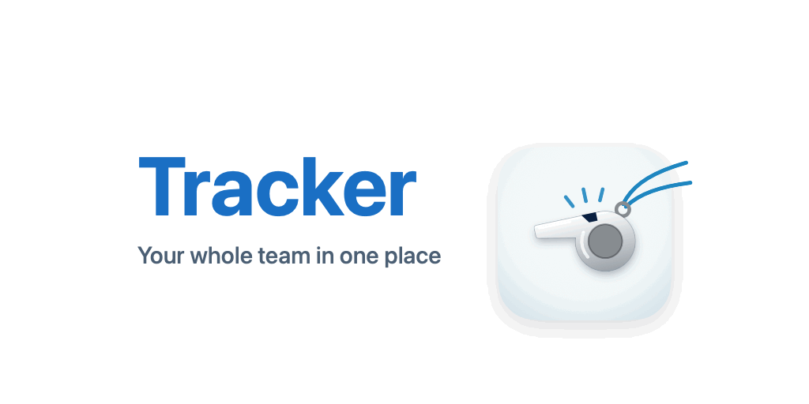
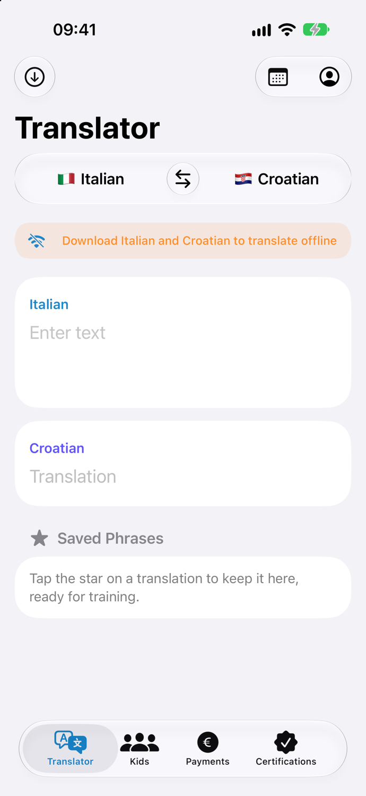
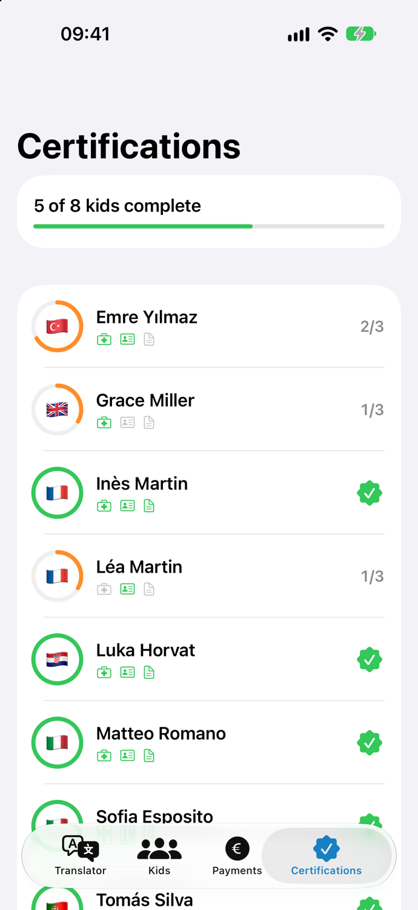
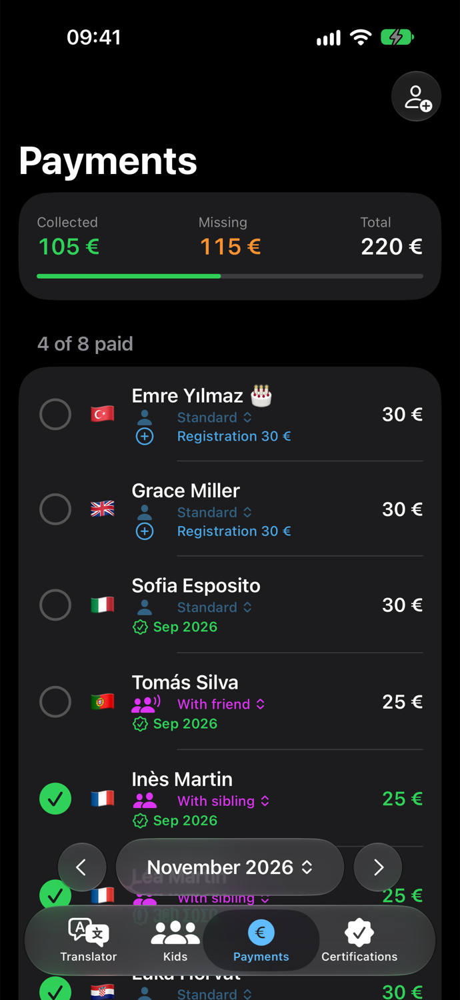

# Tracker: A Team App for Kids' Coaches

**Your whole team in one place.** Tracker is an iPhone app for coaching a kids' team: who's on the team, who has paid this month, which documents are still missing, whose birthday is coming up, and a translator that works offline for talking with kids who speak another language.

<p align="center">
  
  
  
  
  
</p>

<sub>The kids in the screenshots are made up.</sub>

- **Platforms:** iPhone, iOS 26.0+
- **Language:** Swift with SwiftUI and SwiftData. One dependency: Google ML Kit for offline translation, through CocoaPods.
- **Privacy:** everything stays on the iPhone. Translation runs on the device.
- **Status:** a working app, still growing (see [Status](#status-what-is-verified-and-what-isnt)).

---

## Contents

1. [What it does](#what-it-does)
2. [How it works](#how-it-works)
3. [Fees and seasons](#fees-and-seasons)
4. [Design](#design)
5. [Privacy](#privacy)
6. [Technologies](#technologies)
7. [Project structure](#project-structure)
8. [Build and run](#build-and-run)
9. [Status: what is verified and what isn't](#status-what-is-verified-and-what-isnt)

---

## What it does

Four tabs:

1. **Translator.** Type a sentence and translate it between English, Italian, Turkish, Croatian, French and Portuguese, offline. **Read Aloud** speaks it in the right voice, and the star keeps a translation in **Saved Phrases** for the next practice.
2. **Kids.** Every kid with their flag, age and parents' names. Sort by name, age, nationality or newest, and filter by nationality. A cake shows next to anyone with a birthday this month.
3. **Payments.** One list per month: tick who paid. Still to pay stays on top, paid goes to the bottom, each group A–Z. The card at the top shows what's collected, what's missing and the total.
4. **Certifications.** Each kid needs a medical certificate, an ID copy and a registration form. A ring shows how many are in, and the top card says how many kids are complete.

Also:

- **Documents.** Scan a paper with the camera, or import a file. Open any file to preview it.
- **Birthdays.** Reminders a week before and two days before, then on the day. Opening the app on someone's birthday shoots confetti and shows "Happy birthday".
- **Practice log.** A calendar of practice days (Tuesdays and Thursdays): held, or not held with a reason.
- **My profile.** The coach's name, phone, email, picture, ID document and other files.

---

## How it works

### Data (`Tracker/Models/Models.swift`)

SwiftData models: `Kid`, `Coach`, `StoredFile`, `PaymentEntry` and `PracticeDay`. A kid owns their files and payment entries, and deleting a kid deletes those too. Files are stored as external data, so big scans don't slow the database down. New fields are only ever added with defaults, so updates never lose saved data.

### Payments (`Tracker/Payments/PaymentsView.swift`)

A month is a list of `PaymentEntry` rows, one per kid on the team that month. An empty month offers the latest earlier list as a template, keeping each kid's last fee.

### Translation (`Tracker/Translator/TranslationEngine.swift`)

ML Kit downloads one model per language once, then translates without a connection. Apple's Translation framework has no Croatian, which is why ML Kit is used. The engine is wrapped in `#if canImport(MLKitTranslate)`, so the rest of the app still builds without the pod.

### Birthday reminders (`Tracker/Shared/BirthdayReminders.swift`)

Reminders go out a week and two days before (at 10:00), then on the day at 00:00, 09:00 and 13:00. iOS keeps at most 64 pending notifications per app, so only the soonest 60 are scheduled, and the list is rebuilt whenever a name or birthday changes.

---

## Fees and seasons

| | Amount |
| --- | --- |
| Monthly fee | 30 € |
| Monthly fee with a sibling or a friend | 25 € |
| Registration, once per season | 30 € |

A season runs from September to August. A registration paid in any month of the season counts for the whole season.

---

## Design

- Standard iOS look with Liquid Glass tab and toolbar buttons, in light and dark mode.
- Status in words and icons, not colour alone: "4 of 8 paid", "2/3", a check or a ring.
- Haptics on uploads and on the birthday celebration. With Reduce Motion on, the celebration shows only the pill, without confetti.

---

## Privacy

- Kids, payments, files and notes are stored on the iPhone with SwiftData.
- Translation models run on the device. The only network use is downloading a language model when you ask for it.
- No account, no ads, no analytics.

---

## Technologies

| Area | Frameworks and techniques |
| --- | --- |
| Language | Swift, main-actor default isolation with Approachable Concurrency |
| UI | SwiftUI, `Tab` API, searchable country picker, custom confetti |
| Data | SwiftData with cascade relationships and external storage |
| Documents | VisionKit document camera, PDFKit, QuickLook, file importer |
| Translation | Google ML Kit Translate (CocoaPods), AVSpeechSynthesizer |
| Reminders | UserNotifications |
| Checks | `#if DEBUG` self-checks for months, seasons and fees, run at launch |

---

## Project structure

```
Tracker/
├── Tracker/
│   ├── TrackerApp.swift      Tabs and the birthday celebration
│   ├── Models/               SwiftData models, fees, months and seasons
│   ├── Translator/           Translator, offline languages, practice log, coach profile
│   ├── Kids/                 Team list and kid profiles
│   ├── Payments/             Monthly lists and the month picker
│   ├── Certifications/       Documents per kid
│   ├── Shared/               Documents, countries, birthdays, confetti
│   └── Assets.xcassets
├── Tracker.xcodeproj
├── Tracker.xcworkspace       Open this one (CocoaPods)
├── Podfile
└── .github/                  Banner and README screenshots
```

---

## Build and run

Requirements: Xcode 27 and CocoaPods on macOS.

```bash
pod install
open Tracker.xcworkspace
```

Pick the **Tracker** scheme and run on an iPhone. Signing uses your own team.

---

## Status: what is verified and what isn't

**Verified**

- The app minus the ML Kit pod builds and runs in the iOS simulator. The screenshots come from that build, filled with made-up kids.

**Not verified yet**

- ML Kit has no Apple silicon simulator build, so the full app with the pod was not run in the simulator for this README, and it was not run on a device either.
- There is no unit test target. The month and fee maths is covered only by the debug self-checks.

---

© 2026 Alessandro Signorile. All rights reserved.
